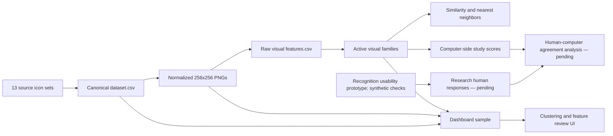

# Thesis Repository Wiki

This wiki is the organized knowledge base for people and AI agents working in this repository. It explains the research boundary, data, processing pipeline, visual features, analysis outputs, dashboard, literature evidence, evaluation plan, and safe working practices.

The wiki explains the system; it does not replace generated metadata or executable code as the source of truth. When a dated count or behavior disagrees with a current generated artifact or script, verify the artifact or script and update the wiki.

## Start Here

| Need | Page |
|---|---|
| Understand the thesis and its boundaries | [Thesis overview](thesis-overview.md) |
| Read the complete meeting evidence and verified current decisions | [Meeting decisions and current state](meeting-decisions-and-status.md) |
| Review the new meeting and revised pilot action items | [Recording 4 summary and tasks](../notes/meetings/standard-recording-4-summary-and-tasks.md) |
| Continue the separate LaTeX thesis document | [Thesis document handoff](../THESIS_DOCUMENT_HANDOFF.md) |
| Use the repository-local thesis-writing skill | [Local thesis-writing skill](../.codex/skills/thesis-writing/SKILL.md) |
| Find a directory, script, input, or output | [Repository architecture](repository-architecture.md) |
| Understand the 13 icon collections and canonical CSV | [Datasets and provenance](datasets-and-provenance.md) |
| Follow data from source icons to analysis artifacts | [End-to-end pipeline](pipeline.md) |
| Understand extraction and all active visual families | [Feature system](feature-system.md) |
| Review the visual audit of all seven representatives across B/W, Red, and Colored icons | [Feature-family visual audit](../audit%20families.md) |
| Understand distance, nearest neighbors, PCA, and clustering | [Similarity and clustering](similarity-and-clustering.md) |
| Use or test every dashboard view | [Dashboard UI](dashboard-ui.md) |
| Change dashboard generation or its JSON/CSV contract | [Dashboard implementation](dashboard-implementation.md) |
| Trace claims to the local papers and research notes | [Literature and evidence](literature-and-evidence.md) |
| Locate the live presentation and its verified claim boundaries | [Progress presentation](progress-presentation.md) |
| Administer the saved desktop recognition usability pilot | [Icon-recognition pilot](icon-recognition-pilot.md) |
| Understand the planned human study and comparison | [Evaluation and human study](evaluation-and-human-study.md) |
| Review the working path from glyph selection to study design | [Current state and user-study plan](../user%20studio/current-state-and-user-study-plan.md) |
| Find runnable commands and script parameters | [Commands and scripts](commands-and-scripts.md) |
| Know which files are generated and by what | [Artifacts and data contracts](artifacts-and-data-contracts.md) |
| Work safely as an AI agent or contributor | [Agent and contributor guide](agent-and-contributor-guide.md) |
| Diagnose failures and verify changes | [Verification and troubleshooting](verification-and-troubleshooting.md) |
| See known gaps and planned work | [Limitations and backlog](limitations-and-backlog.md) |
| Review the staged feature/dashboard architecture plan | [Review, feature pipeline, and dashboard refactoring plan](../tasks/review-feature-dashboard-refactoring-plan.md) |
| Decode project terminology | [Glossary](glossary.md) |
| Maintain this wiki | [Wiki maintenance](wiki-maintenance.md) |

## System at a Glance

## Current Snapshot

Verified on **2026-09-29** from the current CSV/JSON artifacts and dashboard/public-bundle generators:

| Item | Current value |
|---|---:|
| Icon sets | 13 |
| Canonical dataset rows | 28,749 |
| Dashboard source scope | 5 sets / 649 canonical rows: AIGA/DOT, OCHA, Universal Symbols Healthcare Webfont, ISO 7010, ISO 15223 |
| Normalized image size | 256 × 256 PNG |
| Feature-corpus rows | 28,749 |
| Feature CSV columns | 133 total: 23 metadata + 110 raw numeric features (schema v2) |
| Thesis analysis features | 7 representative measurements |
| Active visual families | 7 |
| Feature Groups representatives | 7 fixed configured representatives, one per family; no alternate registry features are exposed in the dashboard |
| Complexity representative | Canny edge density; grayscale quadtree is retained only as a raw traceability column |
| Feature Values features | The 7 configured Feature Groups representatives |
| Feature-v2 release gate | Blocked pending completion of the frozen two-rater benchmark |
| Feature Groups pilot sample | 10 equal-width bins across each eligible representative range, with up to 2 random icons per bin from 397 quality-eligible selected-source rows; 252 uncertain masks are excluded, missing/non-finite representatives would be excluded, and meaningful zeros remain valid |
| Image Clustering sample | Unique seven-family composite from the 397-row eligible pool, up to 20 stratified icons per family; hover/click values and lasso medians are compared with the current composite sample's distribution |
| Feature Groups comparison | Exactly 3 selected sample icons; all 7 representative values in a separate fullscreen modal |
| Generated dashboard rows | 50 for Metadata/Combined projections |
| Generated dashboard sampling | Up to 10 random icons per included set, seed 42 |
| Public dashboard | Live at `https://glyph-perception-dashboard.pages.dev/`; 649 normalized images, five source sets, attribution/licenses, read-only AI, and an access-controlled partial study-stimulus selection and separate anonymous recognition usability pilot backed by EU-jurisdiction D1 |
| AI Clustering experiment | Exact shared Feature Groups sample; explicit OpenRouter image-embedding run; inspectable AI plot with collapsible analysis sidebar, descriptive cluster entries, actual embedding-space contribution, per-cluster feature statistics, complete seven-value icon tables, modal feature-vs-AI comparison, and tracked SQLite cache/history |
| Dashboard variants | Image, metadata, combined |
| Dashboard cluster values | 3, 5, 7, 10 |
| Human-response collection | Recognition usability pilot implemented; synthetic verification only, no research participant dataset or human-computer comparison |
| Historical deployed recognition protocol (2026-09-29) | 20 frozen same-set icons; 3 practice and 20 recorded trials; 3-second exposure at 128 CSS pixels; immutable configurable enlargement levels; separate private results/exports |
| Recognition preview isolation | Separate EU D1 and test secrets; production nominations verified independently |
| Nomination snapshot (2026-09-29 D1 read) | Supervisor-associated entries: 100 and 80; algorithm-assisted `ibtisam`: 100. Smaller `test*` entries: 17 additional rows. Consensus remains pending. |
| Production usability evidence (2026-09-29 D1 read) | Two closed synthetic smoke-test pilots; one ended synthetic session; one answered practice attempt; zero recorded attempts. |
| Stimulus-selection submissions | Implemented for internal reviewers; compact dataset dropdown, full-width synchronized Grid and per-set seven-feature PCA Smart map, modal review/submission, 1–100 icons total with at most 20 per set, pseudonymous reviewer code, an admin-only Submissions tab with guarded deletion, a separate Pilot results tab, screenshot export, and protected CSV export. This is not participant-response collection. |

Pilot administration update verified on **2026-10-06** from the current API, UI and isolated D1 tests: closed pilots can be deleted with their sessions and responses, including unfinished sessions after an explicit warning; reviewer submissions are retained. The dated counts above remain the earlier snapshot.

Controlled-pilot source update on **2026-10-11**: five answer options, 6/8/10/12/14 assigned CSS-pixel sizes, 1.5-second target exposure, three practice plus 100 randomized recorded trials and keyboard answers. The previous runnable workflow is removed; saved records remain exportable. Migration 0003 is required. Production deployment `ec45d507` now serves it. Old pilots/results were deleted at the user’s request, and temporary smoke records were removed. Final 2026-10-11 D1 verification: 649 catalog icons, three reviewer submissions, 280 nominations, zero pilots/sessions/attempts. The older snapshot table above remains historical; see [pilot release evidence](icon-recognition-pilot.md#production-release-2026-10-11).

Full keyboard UI update verified on **2026-10-11**, deployment `b46388a7`: platform-specific keycap badges, Enter/Return lifecycle actions, 0 for unidentified, Ctrl/Command finish/end shortcuts and preserved reflection typing. Local and hosted-assets browser checks passed without production participant writes; see [pilot keyboard operations](icon-recognition-pilot.md).

Local automatic-alternative refinement verified on **2026-10-11** (13 focused tests, Python image checks, combined isolated D1/browser suite and public build): new controlled pilots use seeded source-distinct selection (two near plus a uniform valid pair from original ranks 12–16), canonical pixel hashes and retained small-size collision diagnostics, balanced target positions and additive audit exports. Existing snapshots retain alternatives/schedules; unchecked legacy images display “not checked”. No deployment or production writes are included, and the historical production counts above are unchanged. See [exact rules and verification](icon-recognition-pilot.md#alternative-selection).

Recheck these values with the recipes in [Verification and troubleshooting](verification-and-troubleshooting.md) before making current-state claims.

## Source-of-Truth Order

Use the most direct evidence available:

1. Current executable scripts for behavior and generation rules.
2. Generated JSON/CSV reports for the state of the last completed run.
3. `THESIS_STATUS.md` and `tasks/current-thesis-next-steps.md` for project direction and progress.
4. `icon_data/MANIFEST.md` for source collection provenance.
5. This wiki for organized explanation and routing.
6. Older notes and historical plans for context only.

AI agents must begin with `AGENTS.md`, which makes wiki review and maintenance a completion requirement. Other important entry points include `agent.md`, `code/build_icon_dataset.py`, `code/extract_icon_features.py`, `code/compute_icon_similarity.py`, `code/build_analysis_dashboard.py`, `icon_data/analysis/features_metadata.json`, and `icon_data/analysis/analysis_dashboard/dashboard_data.json`.

## Core Research Boundary

The computer side measures visible properties of glyph images: complexity, shape/silhouette, stroke/structure, density/fill, balance/layout, color/contrast, and texture. Semantic meaning, familiarity, metaphor, cultural knowledge, and learnability are not image-derived visual feature families. They may be metadata, controls, prompts, or human-study outcomes.

Clustering, PCA, and nearest-neighbor results are diagnostic tools. They support the eventual human-computer comparison; they are not the thesis contribution by themselves.

Automatic-alternative production release verified on **2026-10-11**: implementation commit `aff060170`, deployment [`0a3e48c0`](https://0a3e48c0.glyph-perception-dashboard.pages.dev). The production assets match the tested build and existing frozen pilot configurations/session schedules are unchanged. Pre-release D1 operational snapshot: 649 icons, three submissions, 280 nominations, two pilots, three sessions and 32 attempts. No migrations, reseeding, participant test writes or deletions were performed. Earlier snapshot counts remain historical; see [release verification](icon-recognition-pilot.md#automatic-alternative-production-release--2026-10-11).
