# Evaluation and Human Study

## Feature-v2 measurement benchmark

Before these seven representatives can be used in a feature-validation pilot, two independent raters must complete the frozen `feature_v2_benchmark.csv`. Each scalar family uses five-point judgments; orientation uses an angle or `undefined`; strict-red rows use `red` or `not_red`; both raters inspect the saved mask overlay and record acceptability and gross inversion.

The benchmark builder obtains the seven family-to-representative mappings and legacy benchmark aliases from `code/thesis_pipeline/features/registry.py`. The evaluator shares the registry's schema version and orientation-confidence threshold. Gate thresholds and result-shape normalization remain a later refactoring stage.

Release requires weighted κ ≥ 0.60 for ordinal judgments, held-out Spearman ≥ 0.60 per scalar, orientation median axial error ≤ 15°, p90 ≤ 30°, undefined F1 ≥ 0.80, strict-red precision 1.00 and recall ≥ 0.80, at least 95% acceptable masks, and zero gross background inversions. Any family failure blocks all seven. The generated gate currently remains pending until ratings exist; do not describe engineering completion as human validation.

[Wiki home](README.md) · [Thesis overview](thesis-overview.md) · [Limitations](limitations-and-backlog.md)

## Status

The final evaluation layer is specified but not implemented end to end. A separate [icon-recognition usability pilot](icon-recognition-pilot.md) now implements anonymous target-matching sessions and progressive response storage. No research participant-response dataset has been collected, and no statistical human-computer comparison has been completed.

The current computer pipeline supplies candidate predictors and diagnostic views. The size-controlled human study is the missing primary evidence layer.

The deployed controlled pilot uses a frozen 20-icon reviewer dataset, three practice trials and 100 randomized recorded icon-size combinations: five choices, assigned 6/8/10/12/14 CSS-pixel candidates, 1.5-second 128-pixel target exposure and keys 1–5. The former enlargement workflow is retired. It uses feature distances to select distractors but does not validate those measurements or satisfy the all-family benchmark gate. See the [pilot contract](icon-recognition-pilot.md).

## Meeting decisions and current nominations

The [full meeting evidence](meeting-decisions-and-status.md) separates the agreed homework (independent same-set nominations, group agreement, then a scaling pilot) from unresolved task and analysis choices. Two supervisor-associated submissions contain 100 and 80 icons; `ibtisam` contains 100 algorithm-assisted nominations. The latter is computational, not a third human rating. Consensus stimuli and the final research design remain open.

The usability prototype's large-target-first exposure includes a memory effect explicitly raised in the meeting at 42:41. Its large target and repeated targets remain memory/learning controls to consider; the new assigned-size pilot does not by itself establish a validated recognition threshold. Production has two closed synthetic smoke-test pilots, one ended session, one answered practice attempt and zero recorded attempts as checked on 2026-09-29.

## Literature-Backed User-Study Distinctions

The presentation's literature review separates outcomes that must not be treated as interchangeable:

- Fuchs et al. (2014), Experiment 2, used a forced-choice similarity task with ordinary online participants. Of 62 accepted Amazon Mechanical Turk workers, 36 were retained after three control questions; they chose the most similar glyph from a highlighted target and eight alternatives. The original PDF p. 6 prints “48 trials per participant,” but its between-subjects fill design implies 3 contour variations × 2 dimensionalities × 4 repetitions = 24 experimental trials per person, consistent with 864 total trials / 36 participants. Treat this as a source inconsistency: omit an unqualified per-person trial count rather than silently asserting either number. Similarity choice had no objectively correct target outside the control questions.
- Legg et al. (2017 issue; copyright 2016) recruited 20 Oxford students or employees and analysed 19 responses. Participants rated 104 glyph pairs on a 0-10 differentiation scale; 96 non-reference pairs were randomized, while eight reference pairs remained fixed. This produced a perceived-distance judgment rather than an identification score.
- Fuchs et al. (2017) reviewed 64 quantitative controlled data-glyph user-study papers. Accuracy appeared in 63 studies, completion time in 42, and qualitative feedback in 19; the review also reports that preference did not always match performance.

These studies support similarity choice, pairwise differentiation, and task-performance measures. They do not directly establish semantic identification or reduced-size discernibility thresholds for heterogeneous icon sets; that remains the thesis's human-evaluation gap.

## Evaluation Layers

### Human Identification

Possible measures:

- correctness or identification accuracy;
- selected/free-text label;
- wrong-label confusion choice;
- confidence;
- response time, if collected;
- minimum identifiable size across the required size conditions.

### Perceived Similarity and Confusability

Possible measures:

- pairwise similarity rating;
- most-similar choice;
- distinguishability/confusability rating;
- confusion matrix derived from identification errors.

### Computer Visual Features

Use active image-derived family values only. Keep raw features and family summaries separately available so aggregation remains auditable.

### Pairwise Distinguishability

Candidate measures:

- total active-feature distance;
- family-wise distance;
- nearest-neighbor rank;
- margin to the nearest competitor;
- future quasi-Hamming-style count of differing visual channels.

### Scale/Display Conditions

Scale is the primary experimental condition, not a feature family. The new controlled pilot assigns 6, 8, 10, 12 and 14 CSS px to five-option candidates; each of 20 targets is tested at every size. Outcomes include accuracy, confidence, confusion and response time. Physical calibration is unresolved; fixed CSS pixels alone do not give a device-independent threshold. Earlier 16–256-pixel proposals and the retired 4–64-pixel enlargement prototype are historical, not selectable current protocols.

### Human-Computer Agreement

Candidate analysis includes correlations, regression or feature importance, agreement cases, mismatch cases, and family contribution to identification/similarity/confusability.

## Planned Study Workflow

```mermaid
flowchart LR
    A["Select representative family features"] --> B["Browse candidate icons"]
    B --> C["Export per-icon and pair scores"]
    C --> D["Choose controlled groups and pairs"]
    D --> E["Render fixed decreasing sizes"]
    E --> F["Write and pilot protocol"]
    F --> G["Collect participant responses"]
    G --> H["Estimate discernibility thresholds"]
    H --> I["Join with computer-side predictors"]
```

## Current Ticket Sequence

| Ticket | Goal | Status |
|---|---|---|
| T-001 | Add black/white/red/other foreground-color cohorts to Feature Groups. | In progress; current brief implements All/B/W/Red/Colored, while the older five-cohort pixel-classification criteria remain unresolved. |
| T-002 | Select representative family features and browse about 20 candidates. | In progress; seven representatives are documented and the live internal reviewer UI accepts 1–100 nominations with up to 20 per each of five sets. Final consensus stimuli remain pending. |
| T-003 | Export per-icon family summaries and pairwise family distances. | Todo; depends on T-002 |
| T-004 | Select controlled icon groups and matched close/distant pairs. | In progress; nominations received, consensus and matched-property groups pending. |
| T-005 | Agree a primary task and review the usability pilot. | In progress; prototype implemented, final research protocol and human pilot pending. |
| T-006 | Define participant schemas, joins, exclusions, and analysis plan. | In progress; usability schema/exports implemented; final joins and analysis pending. |

The detailed acceptance criteria live under `tasks/tickets/` and should be treated as the implementation contract.

## Proposed Response Schemas

These are final-study design targets. The separate implemented usability schema is documented in [Icon-recognition pilot](icon-recognition-pilot.md); it does not implement a pair-rating task or a completed human-computer join.

### Participant × Icon

| Field | Purpose |
|---|---|
| `participant_id` | Pseudonymous participant key. |
| `trial_id` | Unique randomized trial key. |
| `icon_id` | Join to canonical/computer-side scores. |
| `render_size` | Required display-size condition in pixels. |
| `prompt_version` | Protocol traceability. |
| `chosen_label` / `free_label` | Identification response. |
| `correct` | Scored identification outcome. |
| `confidence` | Participant confidence scale. |
| `response_time_ms` | Optional latency. |
| `explanation` | Optional qualitative visual-detail explanation. |

### Participant × Pair

| Field | Purpose |
|---|---|
| `participant_id`, `trial_id` | Participant/trial keys. |
| `icon_id_a`, `icon_id_b` | Stable pair members. |
| `pair_id` | Order-normalized pair key. |
| `similarity_rating` | Human similarity outcome. |
| `confusability_rating` | Human confusion risk outcome. |
| `more_similar_choice` | Choice outcome where applicable. |
| `confidence`, `response_time_ms`, `explanation` | Supporting outcomes. |

Before collection, define allowable values, missing-response codes, exclusion rules, trial randomization, consent/privacy handling, and how correctness is scored for ambiguous labels.

The current `study-selection.html` workflow must not be confused with this participant-response schema. It collects research-group stimulus nominations only. Its outputs decide which icons may enter a later approved and piloted study; they do not measure identification, similarity, confidence, or discernibility.

The 2026-09-29 `ibtisam` submission contains 100 algorithm-selected nominations (20 per set), chosen without using supervisor choices. Its [audit](../icon_data/analysis/study_selections/2026-09-29-researcher-assisted/README.md) documents close measured-profile pairs, a central example, coverage sampling, and technical exclusions. Do not count it as a third independent human reviewer or include it in human inter-rater agreement. Compare it separately as a computational nomination; final stimuli still require research-group consensus and the existing measurement/protocol gates.

## Computer-Side Exports Needed

- one row per `icon_id` with seven normalized family summaries;
- raw active features in a separate table;
- one row per selected pair with total distance and seven family-wise distances;
- preprocessing, scaling, aggregation, and weight metadata;
- source paths and stable identifiers;
- selected-stimulus review notes.

Do not calculate family summaries by naively averaging raw columns with incompatible scales. Define transformations and reliability weighting before aggregation and preserve the specification in metadata.

## Analysis Plan Skeleton

1. Describe participants, exclusions, trials, and missingness.
2. Report identification and similarity outcomes with uncertainty.
3. Join exact stimuli to computer-side scores.
4. Test predeclared correlations or regression models.
5. Compare close/distant controls and target-family manipulations.
6. Inspect agreement and mismatch cases qualitatively.
7. Report sensitivity to feature/family scaling and set composition.
8. Keep exploratory and confirmatory analyses distinguishable.

## Ethical and Methodological Guardrails

- Obtain the required institutional approval/consent before participant collection.
- Store pseudonymous participant identifiers and minimize personal data.
- Pilot instructions and logging before a full study.
- Avoid treating source labels as universally correct meanings when icons are culturally or contextually ambiguous.
- Predefine whether semantic correctness, visual similarity, or both are being judged.
- Do not leak metadata labels into a task intended to measure unaided identification.
